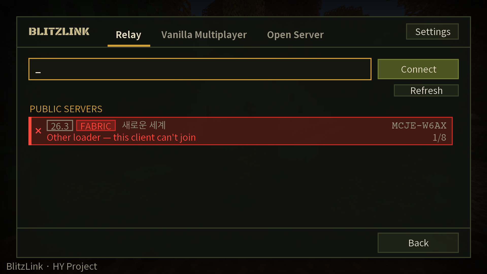
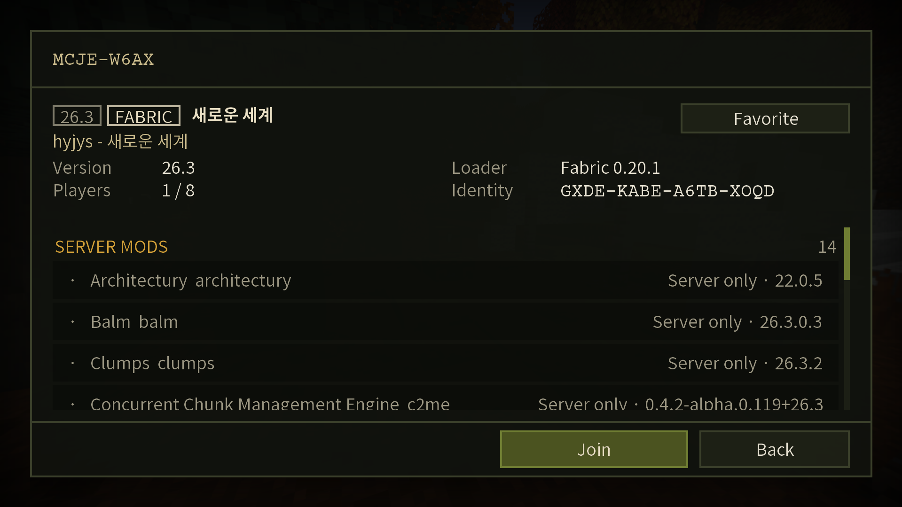

<p align="center"></p>
<p align="center">
  
  
  
</p>

# BlitzLink (26.3)

[English](README.md)

NeoForge·Fabric·버킷 계열 서버(Spigot, Paper 등)를 위한 마인크래프트 서버 매칭. `MCJE-XXXX` 코드 하나로 들어온다.
hyproj.com 중계는 WebRTC Offer/Answer와 공개 목록만 건네고, 게임 데이터는 플레이어와 서버가 직접 주고받는다.

## 스크린샷

<p align="center"></p>
<p align="center">
  
  
</p>
<p align="center">
  
  
</p>

| 경로 | 내용 |
|---|---|
| `common/` | 로더와 무관한 Java(바닐라로 컴파일): UI, 사이드카 제어, 모드 비교, mixin |
| `neoforge/`, `fabric/` | 로더별 진입점과 모드 목록 수집 |
| `bukkit/` | Spigot/Paper 플러그인(호스트 전용) |
| `native/` | Rust: `blitzlink-core`, `blitzlink-relay`(시그널링), `blitzlink-tunnel`(사이드카) |
| `data/net.json` | 중계 주소와 STUN — Rust와 Java가 같이 읽는다 |
| `docs/ko/`, `docs/en/` | `SERVER_GUIDE.md`, `RELAY.md`, `PROTOCOL.md` (한국어 / English) |

## 빌드

```
cd native && cargo build --release          # Windows 사이드카 → native/target/release
./gradlew build                             # build/libs/blitzlink-<버전>+mc26.3.jar (NeoForge+Fabric 하나) + bukkit 플러그인
```

`build`는 **BlitzLink-HAE (Human Art Edition)** `BlitzLink-HAE-<버전>+mc26.3.jar`(태스크 `haeJar`)도 만든다. 내용은 같고 모드 아이콘만 `branding/modrinth/`의 손그림이다. AI 그림을 금지하는 Modrinth용이고, GitHub 릴리스와 CurseForge에는 기본 jar를 올린다.

사이드카 네 가지(Windows x64/arm64, Linux x64/arm64)는 GitHub Actions(`.github/workflows/natives.yml`)에서 빌드하고, `build.yml`이 이를 `natives/`에 받아 jar를 만든다.

## 개발 실행

```
./gradlew :neoforge:runClient -Pblitzlink.relay=http://127.0.0.1:1947 -Pblitzlink.stun=stun:127.0.0.1:3478
./gradlew :neoforge:runServer -Pblitzlink.relay=http://127.0.0.1:1947
```

`-Dblitzlink.tunnel=<경로>`(개발 실행에서만)는 jar에 든 것 대신 로컬에서 빌드한 사이드카를 쓴다.

## 라이선스

Apache License 2.0 — [LICENSE](LICENSE), [NOTICE](NOTICE). 동봉한 글꼴(Black Ops One, Noto Sans KR, Courier Prime)은 SIL Open Font License 1.1을 따른다([docs/license/](docs/license/)).
