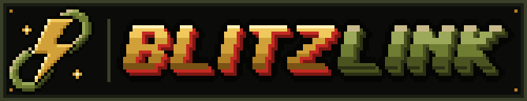
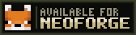
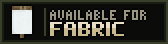
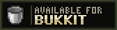
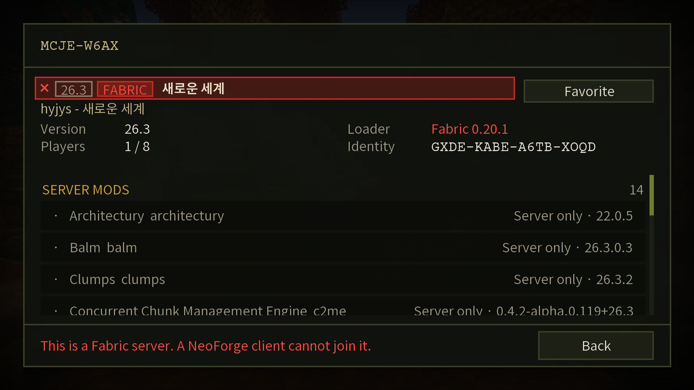
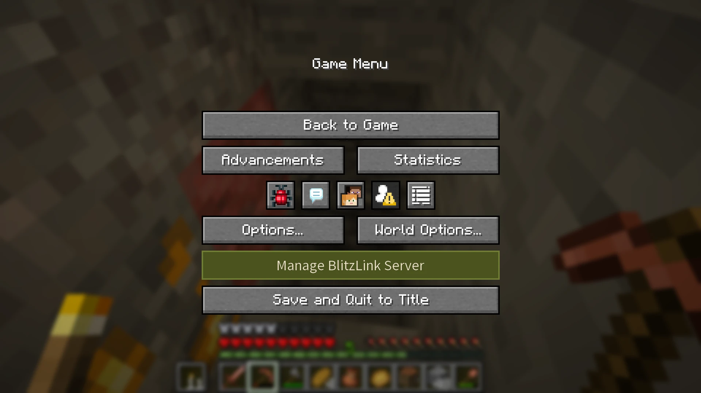

<p align="center"></p>
<p align="center">
  
  
  
</p>

# BlitzLink (26.3)

[한국어](README.ko.md)

Minecraft server matching for NeoForge, Fabric and Bukkit-family servers (Spigot, Paper, …). Join with a `MCJE-XXXX`
code; the hyproj.com relay only passes the WebRTC offer/answer and the public list — game data flows peer-to-peer.

## Screenshots

<p align="center"></p>
<p align="center">
  
  
</p>
<p align="center">
  
  
</p>

| Path | What |
|---|---|
| `common/` | Loader-independent Java (compiled against vanilla): UI, sidecar control, mod comparison, mixins |
| `neoforge/`, `fabric/` | Loader entrypoints and mod-list collection |
| `bukkit/` | Spigot/Paper plugin (host only) |
| `native/` | Rust: `blitzlink-core`, `blitzlink-relay` (signalling), `blitzlink-tunnel` (sidecar) |
| `data/net.json` | Relay URL and STUN servers, read by Rust and Java |
| `docs/en/`, `docs/ko/` | `SERVER_GUIDE.md`, `RELAY.md`, `PROTOCOL.md` (English / 한국어) |

## Build

```
cd native && cargo build --release          # Windows sidecar → native/target/release
./gradlew build                             # build/libs/blitzlink-<version>+mc26.3.jar (NeoForge+Fabric in one) + bukkit plugin
```

`build` also makes `BlitzLink-HAE-<version>+mc26.3.jar` (task `haeJar`), **BlitzLink-HAE (Human Art Edition)**: the same jar with the hand-drawn icon from `branding/modrinth/`, for Modrinth, which does not allow AI-generated art. GitHub releases and CurseForge use the default jar.

All four sidecars (Windows x64/arm64, Linux x64/arm64) are built on GitHub Actions (`.github/workflows/natives.yml`); `build.yml` downloads them into `natives/` and builds the jars.

## Dev runs

```
./gradlew :neoforge:runClient -Pblitzlink.relay=http://127.0.0.1:1947 -Pblitzlink.stun=stun:127.0.0.1:3478
./gradlew :neoforge:runServer -Pblitzlink.relay=http://127.0.0.1:1947
```

`-Dblitzlink.tunnel=<path>` (dev runs only) uses a locally built sidecar instead of the bundled one.

## License

Apache License 2.0 — see [LICENSE](LICENSE) and [NOTICE](NOTICE). Bundled fonts (Black Ops One, Noto Sans KR, Courier Prime) are under the SIL Open Font License 1.1 ([docs/license/](docs/license/)).
